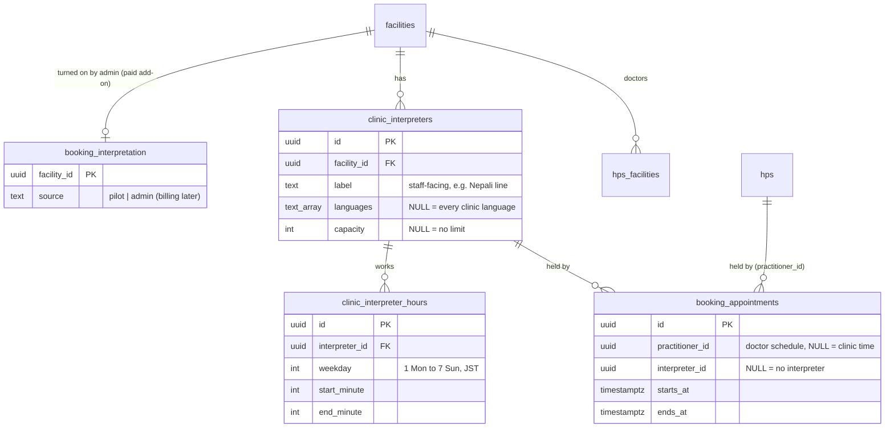
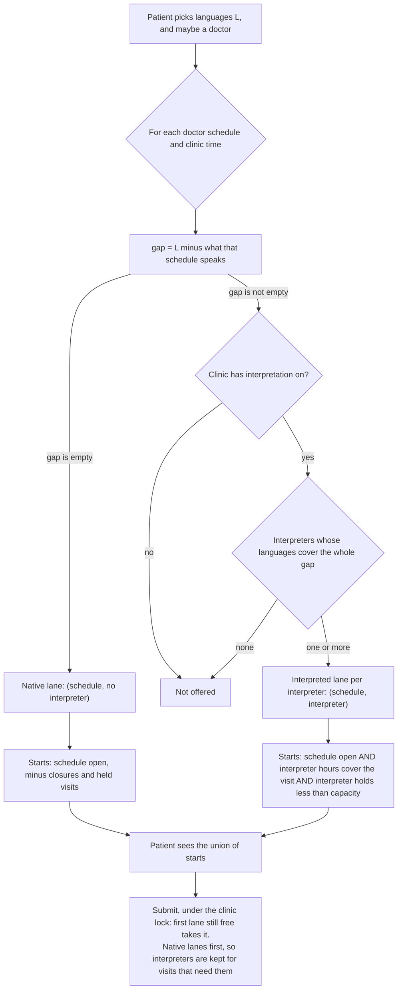

# Booking interpretation

How a clinic offers visits in languages its doctors do not speak (#205). Code
follows this file. `booking-access.md` has the rest of the booking rules.

## The idea in one paragraph

A patient picks the languages they need. A visit is bookable when a **doctor**
is free and, for any chosen language that doctor does not speak, an
**interpreter** who covers it is free for the whole visit. A clinic describes
its interpreters once: which languages each covers, when each works, and how
many visits each can take at once. Every one of those has an "all" default, so
a clinic that only says "we offer interpretation" gets every language, at every
open time, with no limit.

## Data model

| Table | Who writes it | Meaning |
| --- | --- | --- |
| `booking_interpretation` | Admins only (`canChangeInterpretation`) | The clinic may use interpreters. No row: interpreter rows are ignored and booking works as before. |
| `clinic_interpreters` | Clinic owner or admin | One interpreter, a team, or a phone service. |
| `clinic_interpreter_hours` | Clinic owner or admin | When that interpreter works. **No rows: whenever the clinic is open.** |
| `booking_appointments.interpreter_id` | Submit | The interpreter this visit holds. It counts against `capacity` like a doctor's slot. |

### Defaults

| Field | Empty means | Example of narrowing it |
| --- | --- | --- |
| `languages` | Every language the clinic lists (facility, doctors, and other interpreters) | `{ne_NP}`: this interpreter covers Nepali only |
| hours | Every time the doctor or clinic is open | Mon and Wed 10:00–14:00 |
| `capacity` | Any number of visits at once | `1`: one visit at a time |

When an admin turns interpretation on and the clinic has no interpreter rows,
one row is added with every field empty. That is the pilot's setup: every
language, all open times, no limit. The clinic narrows it, or replaces it with
named interpreters, from Settings. Turning interpretation off keeps the rows,
so turning it back on restores them.

## Matching a request

`scheduleLanes` (`src/booking/practitioners.ts`) lists the schedules to try. A
lane is a doctor schedule (or clinic time) plus, when needed, one interpreter.

Rules that keep the mix-and-match small:

- **One interpreter per visit.** It must cover every chosen language the doctor
  does not speak. Two interpreters on one visit is not offered.
- **What a schedule speaks.** A doctor speaks their `spoken_languages`. Clinic
  time is native when `facilities.supported_languages`, or one doctor on clinic
  time, speaks every chosen language (unchanged from before). For the gap an
  interpreter must fill, clinic time speaks `facilities.supported_languages`.
- **The interpreter's hours cover the whole visit.** A 60-minute visit at 13:30
  needs the interpreter until 14:30.
- **Capacity counts held visits** (`requested` and `confirmed`) with that
  `interpreter_id`. Submit counts them inside the clinic's advisory lock, so two
  patients cannot take the last place at once.
- **Clinic closures** close interpreted visits too, because the doctor schedule
  is closed. An interpreter has no closures of their own; staff change the hours.
- **A chosen doctor** keeps their schedule. If they do not speak a chosen
  language, only interpreted lanes for that doctor are tried.
- **The Book page** lists a doctor when they speak every chosen language or an
  interpreter covers the gap (`BookingForm.interpreters`, languages only; the
  label stays with staff). Times then come from the starts query above.

### Examples

A clinic with Dr A (Japanese), Dr B (Japanese, English), and two interpreters:
Nepali on weekdays 10:00–12:00 (capacity 1), and a phone service for every
clinic language, no hours, no limit.

| Patient picks | Lanes tried, in order |
| --- | --- |
| Japanese | A, B, clinic time (all native) |
| English | B (native), then A + phone service, clinic time + phone service |
| Nepali, Mon 10:00 | A + Nepali, A + phone, B + Nepali, B + phone, clinic + … |
| Nepali, Mon 13:00 | A + phone, B + phone (Nepali is off) |
| Nepali, two patients Mon 10:00 | First takes A + Nepali. Second takes B + phone, because Nepali's capacity is 1 |
| Korean (not a clinic language) | Nothing interpreted: the phone service covers clinic languages only |

## What staff see

- The request detail and the clinic notice show the chosen languages and the
  interpreter's label, so staff know who to book in.
- Deleting an interpreter with an upcoming held visit is refused
  (`INTERPRETER_HAS_BOOKINGS`). Past visits keep the row, or `NULL` once it is
  deleted.

## Not in this change

- Patient-side interpreter request or consent. If the law needs a record that
  an interpreter was used, it goes on the staff side of the request (#205).
- Interpreter closures, one-off windows, and a calendar row per interpreter.
- Billing. It replaces the body of `canChangeInterpretation` and writes
  `booking_interpretation.source`.

## Personal data

`clinic_interpreters.label` is a staff-facing label, such as "Nepali line" or a
service name. It is not shown to patients and not logged. It is deleted with
the row or the facility.
